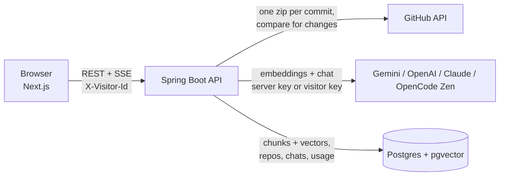

<p align="center"></p>

<h1 align="center">DevPilot</h1>

Ask any public GitHub repo how it works. Paste a link, DevPilot reads the code once, and you chat with it: answers stream in word by word, and every source is a link to the exact lines on GitHub.

No sign-up and no key to paste. The server owner sets one free Gemini key, and daily limits keep that free quota from running out. Anyone who wants more can paste their own key and skip the limits.

## What you can do

- **Paste a repo and index it.** DevPilot downloads it as one zip, splits the code at class and method boundaries and stores embeddings in Postgres (pgvector). Progress shows live as "x/y files".
- **Ask in plain English.** "Where is the owner validated?", "Which endpoint adds a pet?" Answers cite `File.java:41-88` chips that open GitHub at the indexed commit.
- **Re-index after new commits.** Only the changed files are embedded again. No change, no work.
- **Your list stays yours.** Each browser gets an anonymous id, so you only see the repos you added. A repo two people add is indexed once and shared under the hood.

## Run it locally

You need Docker, Java 21 and Node 20+.

```bash
# 1. Database (Postgres 16 + pgvector on port 5433)
docker compose up -d postgres

# 2. Backend on :8080
cd backend
export GEMINI_API_KEY=your-key        # free at https://aistudio.google.com/apikey
export GITHUB_TOKEN=optional-token    # no scopes needed; lifts GitHub's 60 calls/hour limit
./mvnw spring-boot:run

# 3. Frontend on :3000
cd ../client
npm install
echo "NEXT_PUBLIC_API_BASE_URL=http://localhost:8080" > .env.local
npm run dev
```

Open http://localhost:3000, paste `https://github.com/spring-projects/spring-petclinic`, press Index, then Chat.

Never commit a key. Everything secret comes from environment variables.

## Free tier and limits

DevPilot defaults to Google's Gemini API free tier: `gemini-3.5-flash-lite` for answers and `gemini-embedding-2` for embeddings. Google's pricing page lists both as "Free of charge" on the free tier (checked October 10, 2026). Google's own limits, from its [rate limits page](https://ai.google.dev/gemini-api/docs/rate-limits): limits are per Google Cloud project, not per key, and "Requests per day (RPD) quotas reset at midnight Pacific time". Your project's exact numbers are shown in AI Studio.

What I measured with a free-tier key: Google's 429 reply names the embedding limit as `embed_content_free_tier_requests, limit: 100` per minute, and every text in a batch counts as one request. So a repo with more than about 100 chunks hits the limit mid-index. DevPilot waits the time Google asks for ("Please retry in 32s"), shows "Waiting for the free per-minute limit" in the progress bar, and carries on.

To keep one free key alive on a public site, the server enforces (all configurable, `0` switches a limit off):

| Limit | Default | Env var |
|---|---|---|
| Questions per visitor per day | 30 | `LIMIT_QUESTIONS_PER_VISITOR` |
| Index runs per visitor per day | 5 | `LIMIT_INDEXES_PER_VISITOR` |
| Questions per day, whole site | 1000 | `LIMIT_QUESTIONS_GLOBAL` |
| Index runs per day, whole site | 100 | `LIMIT_INDEXES_GLOBAL` |
| Largest repo accepted | 60 MB | `MAX_REPO_MB` |
| Most code files per index | 800 | `MAX_INDEX_FILES` |

Counters live in Postgres, so a restart does not reset them, and the day rolls over at midnight Pacific, the same moment Google resets its daily quota. A visitor who runs out sees "You've used today's 30 free questions. Come back tomorrow." The visitor id is kept in the browser, so clearing site data resets a visitor's own count; the site-wide cap is the hard stop. If Gemini itself answers 429, chat retries twice with a back-off before saying "The free Gemini quota is busy right now. Wait a minute and try again."

### Google's free-tier data terms

Read these before you put a free key on a public site. From Google's [Gemini API Additional Terms](https://ai.google.dev/gemini-api/terms), under Unpaid Services:

> When you use Unpaid Services, including, for example, Google AI Studio and the unpaid quota on Gemini API, Google uses the content you submit to the Services and any generated responses to provide, improve, and develop Google products and services and machine learning technologies, including Google's enterprise features, products, and services, consistent with our Privacy Policy.

> To help with quality and improve our products, human reviewers may read, annotate, and process your API input and output.

> Do not submit sensitive, confidential, or personal information to the Unpaid Services.

DevPilot only indexes public repositories, and private repos are refused even if the server's GitHub token could read them. Questions visitors type are sent to Google too, so the site should say so (the frontend shows which model answers).

### Use your own key (optional)

When a visitor hits the daily limit, or any time, the "Use your own key" button lets them pick who answers and paste that provider's key. The model field comes prefilled and can be changed.

| Provider | Default model | API used | Indexing |
| --- | --- | --- | --- |
| Gemini | `gemini-3.5-flash-lite` | Google Generative Language API | the same key, no daily limit |
| OpenAI | `gpt-6-luna` | Chat Completions, streaming | Gemini (see below) |
| Claude | `claude-sonnet-5-5` | Anthropic Messages API, streaming | Gemini (see below) |
| OpenCode Zen | `deepseek-v4.1-flash` | `https://opencode.ai/zen/v1/chat/completions` | Gemini (see below) |

Questions on a visitor's own key skip the daily question limit. Search vectors always come from Gemini, so a repo indexed once stays searchable for everyone: with an OpenAI, Claude or OpenCode key, indexing uses the visitor's optional Gemini key if they add one, otherwise the free server key (and counts toward the daily index limit). The panel says so.

OpenCode Zen's free models do not work here: called from a server, Zen answers `403 FreeTierError` "OpenCode's free tier can only be used from within OpenCode", so a paid model is needed. Bad keys, an empty balance, a wrong model name and the Zen free-tier refusal each come back as one plain sentence.

The keys stay in the visitor's browser (localStorage) and travel as headers on their own requests only (`X-Chat-Provider`, `X-Chat-Key`, `X-Chat-Model`, and `X-Gemini-Key` for a Gemini key). The server builds a model for that request and drops it. It never stores or logs the key; a test checks that no key reaches the database.

The server itself can also run on OpenAI instead of Gemini (`AI_PROVIDER=openai`, `OPENAI_API_KEY`). Each provider keeps its own vector table because embedding sizes differ.

## Deploy for free

- [docs/DEPLOY-FREE.md](docs/DEPLOY-FREE.md): Neon (database) + Render (backend) + Vercel (frontend), no card.
- [docs/DEPLOY-ORACLE.md](docs/DEPLOY-ORACLE.md): one Oracle Ampere VM running `docker-compose.prod.yml`.

## Architecture



- `services/indexing`: zip download, file filter, class/method chunker, incremental re-index.
- `services/ai`: provider factory, Gemini chat and embeddings, retries on 429, retriever, prompt, SSE stream.
- `services/limits`: the daily usage limiter.
- `services/github`: GitHub client with a rate limiter; refuses private repos.

## API

| Method | Endpoint | What it does |
|---|---|---|
| GET | `/api/usage` | Model in use, today's remaining free questions and index runs, and whether the visitor's own key is in use |
| GET | `/api/repos` | This visitor's repos |
| POST | `/api/repos/by-url` | Add a public repo `{owner, name}` |
| POST | `/api/repos/{id}/index` | Start (or re-run) indexing, 202 |
| GET | `/api/repos/{id}/status` | Live progress |
| DELETE | `/api/repos/{id}` | Remove from this visitor's list |
| POST | `/api/chat/sessions` | New chat for a ready repo |
| GET | `/api/chat/sessions/{id}` | Chat history |
| POST | `/api/chat/sessions/{id}/messages` | Ask; answer streams as SSE (`token`, `assistant_message`, `done`, `error`) |

Every call carries `X-Visitor-Id`, the anonymous browser id. It is not a login. Calls may also carry `X-Chat-Provider`, `X-Chat-Key`, `X-Chat-Model` and `X-Gemini-Key` when the visitor chose to use their own key.

## Tests

```bash
cd backend && ./mvnw verify     # unit tests + Testcontainers end-to-end test (needs Docker)
cd client && npm run lint && npm run build
```

GitHub Actions runs both on every push.

## Credits

- Headline animation: [ObsidianUI FlipText](https://www.obsidianui.dev/docs/flip-text) (MIT).
- Built with Spring Boot, Spring AI, pgvector, Next.js, Tailwind CSS and TanStack Query.
