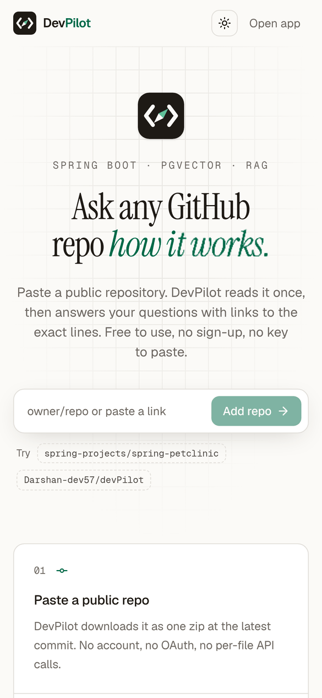
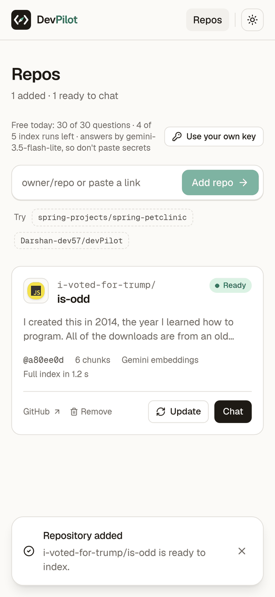
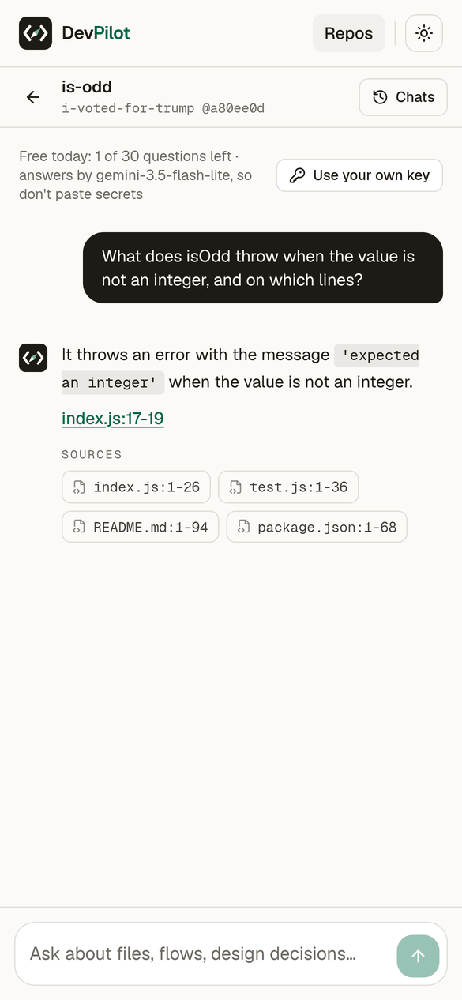
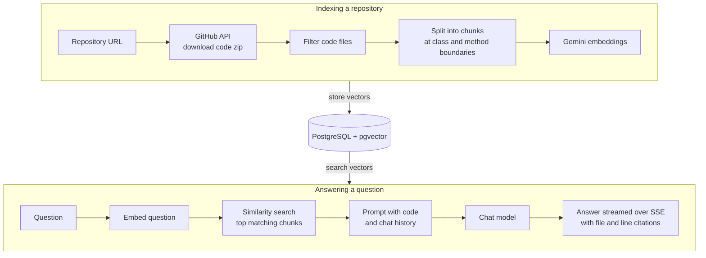

<p align="center"></p>

<h1 align="center">DevPilot</h1>

<p align="center"><b>Chat with any public GitHub repository. Every answer cites the exact lines it came from.</b></p>

<p align="center">
  <a href="https://dev-pilot-nu.vercel.app"><b>Live demo</b></a>
</p>

<p align="center">
  
  
  
  
  
</p>

<p align="center">
  
  
  
</p>

## What it does

Paste a GitHub repository link and DevPilot indexes the code. Then ask questions in plain English, such as "Where is the owner validated?" or "Which endpoint adds a pet?". Answers stream in as they are written, and each citation (for example `PetValidator.java:41-48`) opens those exact lines on GitHub at the indexed commit.

## Features

- **Index any public repository** from its URL, with live progress.
- **Cited answers** that link to the exact file and lines on GitHub.
- **Streaming responses** over Server-Sent Events.
- **Follow-up questions** that use the earlier turns of the chat.
- **Incremental re-indexing**: after new commits, only the changed files are processed again.
- **No sign-up**: each browser gets an anonymous id and its own list of repositories.
- **Bring your own key**: use your own Gemini, OpenAI, Claude or OpenCode key, stored only in your browser.

## Architecture



1. **Indexing** runs in the background. The backend downloads the repository as a zip at its latest commit, keeps the code files, splits them at class and method boundaries, embeds each chunk and stores the vectors in pgvector.
2. **Re-indexing** asks GitHub which files changed since the indexed commit and embeds only those.
3. **Answering** embeds the question, finds the closest chunks for that repository, and sends them to the chat model together with recent chat history.
4. The answer streams back to the browser token by token, and the cited chunks become links to GitHub.

## Tech stack

| Layer | Technology |
| --- | --- |
| Backend | Java 21, Spring Boot 4, Spring AI |
| Database | PostgreSQL 16 with pgvector |
| AI | Google Gemini (chat and embeddings); OpenAI, Claude, OpenCode optional |
| Frontend | Next.js 16, React 19, Tailwind CSS 4, shadcn/ui, TanStack Query |
| Hosting | Vercel (frontend), Render (backend), Neon (database) |

## Getting started

### Prerequisites

- Java 21
- Node.js 20 or later
- Docker (for PostgreSQL with pgvector)
- A Gemini API key from [Google AI Studio](https://aistudio.google.com/apikey)

### Environment variables

Backend:

| Variable | Required | Description |
| --- | --- | --- |
| `GEMINI_API_KEY` | Yes | Your Gemini API key |
| `GITHUB_TOKEN` | No | GitHub token to raise the GitHub API rate limit |
| `DATABASE_URL` | No | JDBC URL (defaults to the local Docker database) |
| `DATABASE_USERNAME` | No | Database user |
| `DATABASE_PASSWORD` | No | Database password |
| `CORS_ALLOWED_ORIGINS` | No | Allowed frontend origins |

Frontend (`client/.env.local`):

| Variable | Description |
| --- | --- |
| `NEXT_PUBLIC_API_BASE_URL` | Backend URL, for example `http://localhost:8080` |

All optional settings, with their defaults, are in `backend/src/main/resources/application.properties`.

### Run locally

```bash
# 1. Start PostgreSQL with pgvector (port 5433)
docker compose up -d postgres

# 2. Start the backend (port 8080)
cd backend
export GEMINI_API_KEY=<your-key>
./mvnw spring-boot:run

# 3. Start the frontend (port 3000)
cd ../client
npm install
echo "NEXT_PUBLIC_API_BASE_URL=http://localhost:8080" > .env.local
npm run dev
```

Open http://localhost:3000, paste a repository link such as `https://github.com/spring-projects/spring-petclinic`, then index it and start chatting.

To deploy, see [docs/DEPLOY-FREE.md](docs/DEPLOY-FREE.md) (Vercel, Render and Neon) or [docs/DEPLOY-ORACLE.md](docs/DEPLOY-ORACLE.md) (a single VM with Docker Compose).

## API overview

All requests carry an `X-Visitor-Id` header, the anonymous browser id.

| Method | Endpoint | Description |
| --- | --- | --- |
| `POST` | `/api/repos/by-url` | Add a public repository |
| `GET` | `/api/repos` | List your repositories |
| `POST` | `/api/repos/{id}/index` | Start or re-run indexing |
| `GET` | `/api/repos/{id}/status` | Indexing progress |
| `DELETE` | `/api/repos/{id}` | Remove a repository from your list |
| `POST` | `/api/chat/sessions` | Start a chat for an indexed repository |
| `GET` | `/api/chat/sessions/{id}` | Chat history |
| `POST` | `/api/chat/sessions/{id}/messages` | Ask a question (answer streams as SSE) |
| `GET` | `/api/usage` | Remaining daily usage |

## Project structure

```
devPilot/
├── backend/                 Spring Boot API
│   └── src/main/java/devPilot/backend/
│       ├── controllers/     REST endpoints
│       ├── services/
│       │   ├── indexing/    download, filter, chunk, embed
│       │   ├── ai/          retrieval, prompts, chat models, streaming
│       │   ├── github/      GitHub API client
│       │   └── limits/      daily usage limits
│       ├── entity/          JPA entities
│       └── repository/      data access
├── client/                  Next.js frontend
├── docker/                  database init scripts
├── docs/                    deployment guides and screenshots
└── docker-compose.yml       local PostgreSQL with pgvector
```

## Usage limits

The public demo allows 30 questions and 5 indexing runs per visitor per day, for repositories up to 60 MB; using your own key removes the question limit. Self-hosted limits are set with the `LIMIT_*` and `MAX_*` environment variables.

## Credits

- Headline animation: [ObsidianUI FlipText](https://www.obsidianui.dev/docs/flip-text) (MIT).
